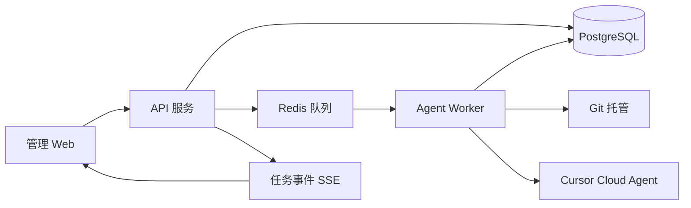
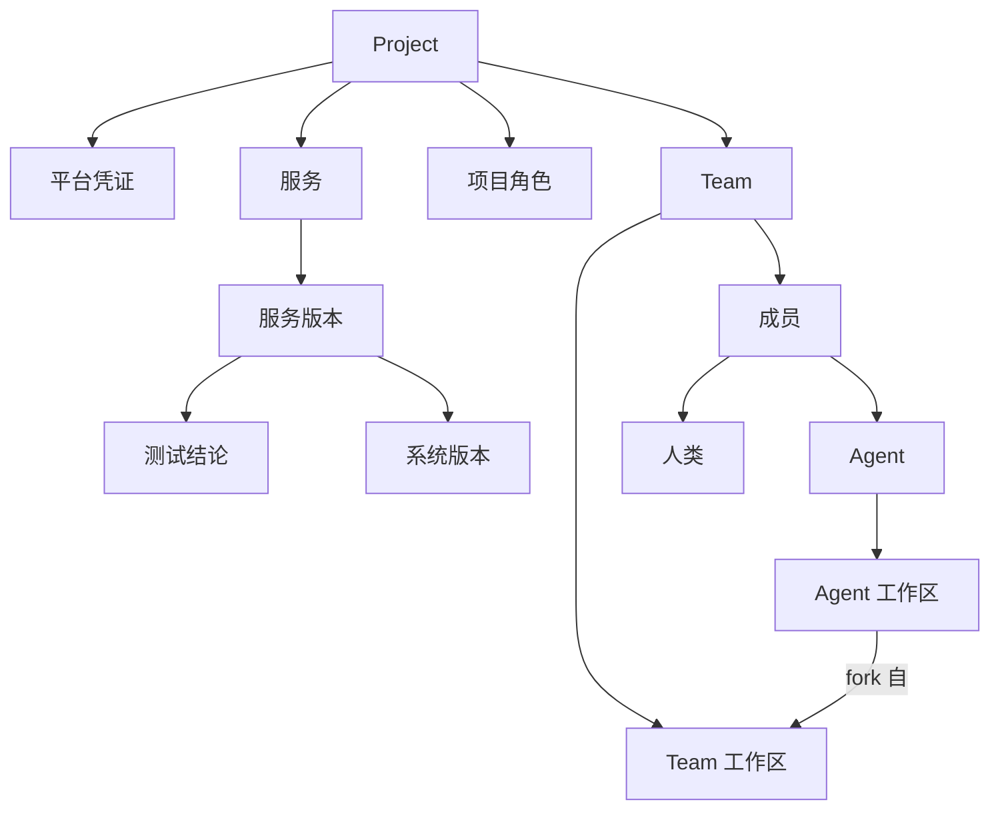

# AgentTeam 辅助软件开发平台设计

## 1. 目标

AgentTeam 是一套 B/S 架构的管理平台，用来组织人和 Agent 共同完成软件开发。用户登录 Web 后，先配置项目，再在项目上创建 Team。Team 成员包含人类和 Agent。Agent 从项目角色中选择身份，拥有职责和工作区；工作区从 Team 工作区 fork 而来。

平台服务的对象是大型云原生微服务项目：每个服务独立版本管理；软件开发工程师和测试工程师只开发和测试被分配的服务；版本经理把已测试通过的服务版本组装成系统版本。

本期 Agent 底座是 Cursor Cloud Agent。Codex、DeepSeek 通过同一套平台适配器接入，本期不实现。

## 2. 设计决策

1. 浏览器只调用本系统 API，不直接访问 Cursor。
2. 技术栈为 React + TypeScript 前端、NestJS 后端、PostgreSQL、Redis。后端与 `@cursor/sdk` 同语言。创建 Agent、拉分支、派发任务等长操作由独立 Worker 执行。
3. Cursor 使用 Cloud runtime。Agent 跑在 Cursor 托管环境中，对着指定仓库和分支工作。Local runtime 依赖调用方机器上的目录，不用于这套多用户 Web。
4. Cursor 凭证是 API Key（用户 Key 或 Team Service Account Key）。项目上的平台账号做成凭证抽象：Cursor 填写 API Key；后续平台再按各自方式填写 Key 或账号密码。密钥加密存储，只在 Worker 中解密。
5. 一个微服务对应一个 Git 仓库，独立打 tag。系统版本是服务版本清单，不是把所有服务合成一个 Git tag。
6. 角色属于项目。新建项目时从系统模板复制 5 个内置角色，项目内可以增删改。Agent 只保存 `role_id`，职责文案在每次派发任务时读取，因此修改角色会作用到已绑定的 Agent。

## 3. 总体架构



| 模块 | 职责 |
| --- | --- |
| 身份 | 登录、用户、项目成员权限 |
| 项目 | 项目、平台凭证、服务目录 |
| 角色 | 模板、项目角色、与 Agent 的引用约束 |
| Team | Team、人类成员、Agent 成员、工作区 |
| 工作区 | Team 基线、Agent fork 分支 |
| 版本 | 服务版本、测试结论、系统版本 |
| 平台适配 | 创建、恢复、派发 Agent；本期只有 Cursor |
| 运行 | 异步执行、日志、取消、失败分类 |

API 请求立即返回。Worker 执行创建 Agent、拉分支和派发任务。浏览器用 SSE 查看运行输出。

## 4. 领域模型



约束：

- 先有项目，才有 Team。Team 不能跨项目。
- 服务目录属于项目。Team 工作区只能从本项目的服务中选择。
- Agent 只能分配本 Team 工作区中的服务。
- 软件开发工程师和测试工程师至少绑定一个服务。产品经理、系统架构师、版本经理默认查看 Team 工作区的全部服务，不为自己 fork 开发分支。
- 人类成员有角色，没有平台 Agent，也没有 fork。人在自己的 IDE 中工作，在 Web 上领取需求、评审和批准。

## 5. 角色

### 5.1 内置模板

系统模板固定 5 个。新建项目时复制到项目中。模板之后的修改不覆盖已有项目角色。

| 模板 | 主要产出 | 版本权限 |
| --- | --- | --- |
| 产品经理 | 需求、验收标准 | 不产生代码版本 |
| 系统架构师 | 服务边界、接口契约 | 不发布版本 |
| 软件开发工程师 | 指定服务的实现与候选版本 | 只能给自己被分配的服务创建候选版本 |
| 测试工程师 | 指定服务的测试结论 | 只能给被分配服务的某个候选版本写通过或失败 |
| 版本经理 | 系统版本 | 唯一可以发布系统版本的角色 |

### 5.2 项目角色

项目角色可以增删改。字段包括名称、说明、职责、派发提示词、权限集合。自定义角色从同一套权限中勾选，从而可以进入版本流程。

与 Agent 的关联规则：

- **删除**：仍有 Agent 的 `role_id` 指向该角色时，删除被拒绝，并返回这些 Agent。人类成员占用该角色时同样拒绝。
- **修改**：只更新角色记录。Agent 不复制职责。下次派发时，Worker 读取当前角色的职责和提示词，拼进发给 Cursor 的 prompt。进行中的运行保持启动时的快照。
- **改名和改权限**立即作用于 Web 展示和鉴权。页面和鉴权都按 `role_id` 现查。

Cursor 没有角色字段。角色留在本系统，不写进 Cursor Agent 的不可变配置。

## 6. 项目、Team 与工作区

### 6.1 项目

项目包含名称、说明、服务目录和平台凭证。每个服务包含仓库地址、默认分支和镜像名。镜像 tag 与服务版本号一致，例如 `order-service:1.4.0`。本期只记录这个对应关系，不负责部署到集群。

### 6.2 Team 工作区

Team 工作区是一组「服务 + 基线 ref」。基线 ref 是分支或 tag，表示这个 Team 的共同起点。

### 6.3 Agent 工作区

Agent 工作区从 Team 工作区 fork：

1. 只复制该 Agent 被分配的服务。
2. 对每个服务，从 Team 基线 ref 拉出分支 `agents/{agent}/{service}`。
3. 记录父工作区、父 ref 和分支名。
4. 创建 Cursor Cloud Agent 时，仓库列表只包含这些分支。

开发工程师和测试工程师因此只能修改自己的服务分支。版本经理使用 Team 基线工作区做汇总，不为发布动作再 fork 一套开发分支。

Team 基线前进后，提供显式的「同步上游」：把基线合并进 Agent 分支。同步不自动改写 Agent 正在使用的分支。

测试工程师的工作区额外固定一个被测版本：测试代码放在自己的 fork 分支上，被测对象固定为某个服务版本 tag。

## 7. 版本管理

服务版本和系统版本分开。

### 7.1 服务版本

服务版本属于一个服务仓库，由该服务的开发工程师创建。状态：

```text
draft → ready_for_test → testing → passed | failed
```

通过后打 Git tag，并对应镜像 tag。失败后，开发工程师在原分支上继续，形成下一个候选版本。已通过的 tag 不再移动。

### 7.2 系统版本

系统版本由版本经理创建，内容是「服务 → 已通过的服务版本」。发布前检查每一项都是 `passed`，且属于本项目服务目录。发布后系统版本不可修改；要变更就新建下一个系统版本。

权限边界：

- 开发工程师不能给未分配给自己的服务建版本，也不能发布系统版本。
- 测试工程师不能修改服务候选版本的代码 tag，只能写测试结论。
- 版本经理不能把 `draft` 收进系统版本。

## 8. Cursor 适配

业务层依赖一组固定的平台操作，不依赖 Cursor SDK 的类型：

| 操作 | 行为 |
| --- | --- |
| `verifyCredential` | 保存项目凭证时检查 Key 是否可用 |
| `createAgent` | 按仓库、分支、模型创建 Cloud Agent，返回 `external_agent_id` |
| `resumeAndSend` | 按已保存的 id 恢复 Agent，并发送这一次任务 |
| `getRun` / `cancelRun` | 查询和取消运行 |

Web 上的「创建 Agent」对应 `Agent.create`，返回的 agent id 立即持久化。后续派发使用 `Agent.resume` 和 `send`，以保留对话上下文。一次运行结束必须取得终端状态。启动失败（鉴权、配置、网络）和运行中失败分开记录。

模型在项目凭证上有默认值，Agent 可以覆盖。创建 Cloud Agent 时显式传入 `cloud.repos`，避免 SDK 在未指定运行时时落到本机。

Codex 和 DeepSeek 以后各自实现同一组操作。项目凭证用 `platform` 区分，Team 和 Agent 不感知具体平台。

## 9. 主要流程

### 9.1 配置顺序

1. 用户登录，创建项目，填写 Cursor API Key 和默认模型。
2. 登记微服务和仓库。
3. 确认或调整项目角色。
4. 在项目下创建 Team，从服务目录圈定 Team 工作区。
5. 加入人类成员，或创建 Agent。

### 9.2 创建 Agent

1. 选择角色，填写该 Agent 的职责补充，选择服务。
2. API 校验角色属于本项目，服务属于本 Team。
3. Worker 拉 fork 分支，调用 Cursor 创建 Cloud Agent。
4. 成功后成员状态变为可用。Git 或 Cursor 任一步失败时，成员保持失败状态并允许重试，不留下没有分支的 Agent。

### 9.3 从开发到发布

1. 人在 Web 上创建工作项，指定服务和负责人。
2. 开发 Agent 在自己的服务分支上完成实现，提交候选服务版本。
3. 测试 Agent 将该版本设为被测版本，提交通过或失败。
4. 版本经理把多个 `passed` 服务版本收成系统版本并发布。

## 10. 权限与数据

### 10.1 项目权限

项目有所有者、管理员、成员三级。

- 所有者管理凭证和删除项目。
- 管理员管理服务、角色和 Team。
- 普通成员在 Team 内按角色权限行动。

### 10.2 核心表

`user`、`project`、`project_platform`、`service`、`project_role`、`team`、`team_workspace`、`team_member`、`agent`、`agent_workspace`、`agent_service`、`work_item`、`agent_run`、`service_version`、`test_report`、`system_release`、`system_release_item`。

关键字段：

- `agent.external_agent_id`：Cursor 的 agent id。
- `agent_run`：run id、启动时的角色快照、状态、错误类别。
- `agent_workspace.parent_id`：指向 Team 工作区，表示 fork 关系。

### 10.3 API 分组

`/auth`、`/projects`、`/projects/:id/roles`、`/projects/:id/services`、`/projects/:id/teams`、`/teams/:id/members`、`/agents/:id/runs`、`/services/:id/versions`、`/system-releases`。

删除角色的引用检查在服务端执行。

## 11. 分期

1. 账号、项目、角色、服务、Team、人类成员。角色删除保护在这一期完成。
2. Cursor 创建 Agent、工作区 fork、派发任务和运行日志。
3. 服务版本、测试结论、系统版本。
4. 同步上游，以及 Codex、DeepSeek 适配器。

## 12. 本期不做

- 自动部署到集群。
- Agent 之间无人值守地互相派活。
- 单体仓库内的多服务版本。
